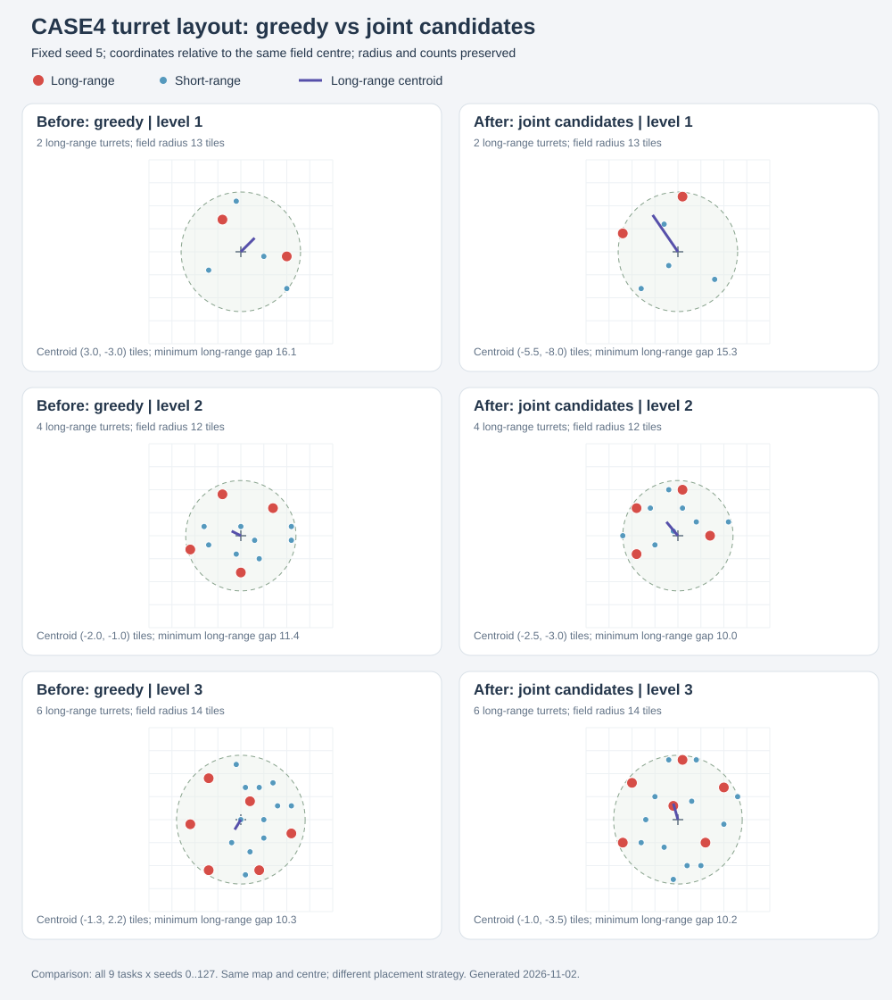

# CASE4-Retreat — 战地撤退

用少量高级屏蔽气垫坦克摧毁左上角区域内的全部敌方炮塔，并用右下角维修湾恢复部队。
Agent 只会收到"清空左上角区域、善用维修湾"这个目标，**不会收到敌军配置、数量或坐标**。
考察的是**战损评估、撤退时机、维修效率、再次投入的节奏**。

本文件只讲**怎么跑、场景怎么布、材料在哪**。指标口径与材料字段见 [METRICS.md](METRICS.md)。
参与者只需要 [START.md](START.md) 与 [command.md](command.md)。

---

## 0. 交付给被测 Agent 的文件

**只交这两份**：

| 文件 | 内容 |
|---|---|
| [START.md](START.md) | 任务、公开规则、参与流程、参与边界 |
| [command.md](command.md) | 完整命令接口（注意文件名是单数；会打进 core jar，供 `rwx-micro-4-help` 逐节读取） |

**本目录其余文件都是管理员/开发者资料，不得出现在 Agent 可见的文件列表里**：

| 文件 | 为什么不给 |
|---|---|
| `README.md`（本文件） | 含炮塔区矩形、落点算法、间距规则、**敌方炮塔数量与类型**、迷雾实现、参数表与预览工具 |
| `METRICS.md` | 含材料字段、指标阈值与扣分口径 |
| `prompt.txt` | 本 CASE 的实现提示词 |
| `score_design.md` | 扣分规则草稿 |
| `evaluate.py`、`score.py`、`baseline.py`、`baselines.json`、`metrics/`、`test/`、`layout-comparison.svg` | 评测实现、基线、布局对比图 |

路由：

- **只测本 CASE** → 只给 `START.md` + `command.md`。
- **一次测全部四个 CASE** → 先给 [`../EVALUATION.md`](../EVALUATION.md)，再给这两份。

---

## 1. 场景布置

### 1.1 地图

矩形 `a × b` 格，`a`、`b` 各自取 `[75,80)` 的整数，由 seed 决定（同 seed 固定）。全草地，**无水域/岩浆/悬崖/资源点**。
20 世界单位/格。`Case4Map` 写出 stock TMX，同目录另有 `map.tmx` 供复盘。

### 1.2 炮塔区（左上 3/5）

炮塔只落在**地图左上角 3/5 区域**：矩形左上顶点与地图左上角重合，宽、高各取地图的 `3/5`
（75..79 格的地图对应 45..47 格），且整片炮塔离地图边界至少 3 格。

1. 在该矩形内随机取**种子中心点**（离我方出生角 ≥22 格），并要求中心到矩形边缘至少 8 格；
2. 半径取"中心到矩形边缘/地图边界的最小余量（含 3 格边距）"，夹到 **8..18 格**；远程塔较多的任务会把下限抬到
   能摆下 10 格间距的值（例如 6 座远程塔取 ≥14 格）；
3. 落点 = 中心 + 半径 × √u × 方向——所以**每座塔到中心点都不超过半径（≤18 格）**，整片区域
   也不会越出 3/5 矩形。

方向规则：

- **远程塔**（`c_turret_t3_gun`、`c_turret_t2_artillery`、`c_turret_t1_artillery`）：候选方向按 80% 使用 `225° ± 35°` 的高斯分布、20% 完全随机抽样。
  在相同间距下尝试 32 组完整远程布局，按整组重心沿 225° 的投影择优，并对侧向漂移轻微扣权，
  让远程火力整体偏向**远离我方出生角**的一侧。80% 是候选方向的抽样概率，不是最终落在左上象限的比例承诺。
- **近程塔**：方向完全随机，在圆盘内填空隙。

间距：远程之间 ≥ 10 格、近程之间 ≥ 3 格、跨类 ≥ 3 格，违反就重抽。远程塔先整组尝试当前间距，
只有所有整组候选均未放下时才统一按 10% 放宽，最低到 40%；近程塔继续逐座抽样放置。
最终坐标再叠加 ±0.35 格抖动；`meta.achievedTurretSpacingTiles` 记录实际最小间距，
`meta.achievedCentreDistanceTiles` 记录实际最小/最大中心距，`meta.region.box*` 记录 3/5 矩形范围。

seed 影响：中心点、方向抽样、抖动与右下角折角点。同布局版本、同 `(task, seed)` 完全复现。
本次整组布局版本写入 `meta.layoutVersion=2`，`region.longRangePlacement=joint_candidates`、`longRangeLayoutTrials=32`。
与旧布局使用相同 seed 时，地图、种子中心和我方出生布局保持一致，远程/近程炮塔落点会改变；旧新布局不作为相同场景混比。

离线对比覆盖全部 9 个 task、seed 0..127（1152 组）：新旧均无放置失败或格点范围/半径越界；
远程塔平均偏移由 `(-1.39,-1.42)` 改为 `(-4.09,-4.00)` 格，远程最小间距由 8.06 格提升至 10 格，
保持完整 10 格远程间距的布局占比由 95.7% 提升至 100%。这是布局采样结果，尚未补真实对局验证。



### 1.3 维修湾与出生点（右下）

维修湾按**折角（L）布局**：折角点 + 两条互相垂直的臂，臂间距 4 格。type 1 只有 2 座，退化为单臂直线（L 形需要 ≥3 座）。

坦克在折角内侧 10 格处、纵向间隔 4 格，朝战场方向留出通道。

### 1.4 兵力表

任务 id：`4_<type 1..3>_<level 1..3>`，`level` 是敌军数量倍率。

| type | 我方 | 维修湾 | 敌方炮塔（×level） | 迷雾 | 游戏上限 |
|---|---|---:|---|---|---:|
| 1 | 屏蔽气垫坦克 ×2 | 2 | `c_turret_t2_gun` ×3、`c_turret_t1_lightning` ×2 | 无 | 15 min |
| 2 | 屏蔽气垫坦克 ×2 | 4 | `c_turret_t2_gun` ×3、`c_turret_t1_artillery` ×2、`c_turret_t2_lightning` ×2 | 普通持续 | 20 min |
| 3 | 屏蔽气垫坦克 ×3 | 4 | `c_turret_t3_gun` ×1、`c_turret_t2_artillery` ×1、`c_turret_t2_gun` ×4 | 普通持续 | 25 min |

> 表里的"×level"是每级数量再乘 level（例如 type1 level2 = 6 座机枪塔 + 4 座电击塔）。

### 1.5 单位与炮塔参数（已按源码核实）

我方 `experimentalHoverTank`（屏蔽气垫坦克）：HP **3500**、护盾 **5000**（每帧回复 0.25）、
攻击 **380** 点瞬击光束、射程 **180** 世界单位（9 格）、速度 0.6/帧（≈36 单位/秒）、转向 1.1。

维修湾 `repairbay`：HP 1000、占地半径 30；**治疗半径 230 世界单位（11.5 格）**；每 40 帧自动挑
"范围内 HP 最低的我方单位"下达 repair 指令；治疗速率 0.2/帧（≈12 HP/秒）；满血目标跳过；**无需玩家命令**。
治疗只加 `currentHealth`，**不加护盾**。

| 内部 ID | 语义 | HP | 射程（世界单位/格） | 冷却 | 单发伤害 |
|---|---|---:|---:|---:|---:|
| `c_turret_t2_gun` | T2 机枪 | 1100 | 185 / 9.25 | 20 帧 | 44 |
| `c_turret_t1_lightning` | T1 电击塔 | 1500 | 210 / 10.5 | 2.00 s | 150 |
| `c_turret_t2_lightning` | T2 电击塔 | 2700 | 250 / 12.5 | — | — |
| `c_turret_t1_artillery` | T1 火炮 | 1000 | 350 / 17.5 | 3.67 s | 见 ini |
| `c_turret_t3_gun` | T3 机枪 | 3900 | 320 / 16 | 13 帧 | 40 |
| `c_turret_t2_artillery` | T2 火炮 | 1800 | 460 / 23 | 1.83 s | 见 ini |

全部 `canAttackLandUnits: true`、`canAttackFlyingUnits: false`。

### 1.6 迷雾

| type | fog | 实现 |
|---|---|---|
| 1 | 无 | `fogEnabled=false`、`fogRenderActive=false`，fog 数据填 0 |
| 2/3 | 普通持续 | `fogEnabled=true`、`fogPeriodicMaintenanceEnabled=true`、`fogRenderActive=false`，fog 数据填 10（从未探索），由单位视野逐步揭示 |

敌方可见性走引擎原生判断：迷雾中的炮塔不会出现在 `unit-list --owner enemy`、`threat-list` 或 `unit-show`。
`meta.fogMode` 为 `0`（无）或 `2`（持续）。

### 1.7 目标与判定

- 公开目标只有一句："摧毁左上角区域内全部敌人，并妥善利用维修湾"。`state` 只给通用目标描述与 `goal.reached`，
  **不给**剩余敌军数量/类型/坐标。
- `success`：本局全部炮塔被摧毁。`defeat`：我方坦克全部阵亡。`timeout`：预算耗尽。`error`：异常。
- 敌方配置（`meta.turrets`）是评测方私有数据，不得经任何 Agent 可访问接口泄露。

### 1.8 改场景与离线预览

场景只由两处代码生成：`Case4Map`（地图尺寸/地面）与 `Case4Retreat`（区域、落点、出生点）。改完不必启动对局即可出图。

| 想改 | 位置 |
|---|---|
| 地图边长 | `Case4Map.MIN_SIZE` / `MAX_SIZE`（默认 `[75,80)`，seed 决定具体值）；想固定尺寸就直接改 `width(seed)`/`height(seed)`。`TILE=20` 是格与世界单位的换算 |
| 炮塔区矩形 | `Case4Retreat.REGION_FRACTION`（3/5）、`FIELD_MARGIN`（离边界 3 格） |
| 场地半径 | `RADIUS_MIN` / `RADIUS_MAX`（8..18）、`regionRadius`、`minimumRadius`（按远程塔 10 格间距反推下限） |
| 种子中心 | `pickCentre`（离矩形边与出生角的约束）、`BASE_CLEARANCE` |
| 远程偏置 | `LONG_RANGE_BIAS_DEGREES` / `LONG_RANGE_BIAS_SPREAD`、`LONG_RANGE_RANDOM_SHARE`、`LONG_RANGE_LAYOUT_TRIALS`、`placeLongRangeGroup` |
| 间距与放宽 | `SPACING_LONG` / `SPACING_SHORT` / `SPACING_CROSS`、`SPACING_FLOOR` / `RELAX_STEPS`、`fits` |
| 落点抽样 | `placeOne`、`drawOne`（半径按 `√u` 均匀采样、`JITTER_TILES` 抖动） |
| 数量/类型/迷雾/时限 | `spec(task)`；维修湾与坦克出生在 `layout()` 的 `bays` / `tanks` 段 |

离线预览（不启动游戏、不读资源，输出 PNG + `layout.json` + `map.tmx`）：

```powershell
.\gradlew.bat :core:previewCase4 -Ptask=4_1_1 "-Pseed=1,2,3,5,8"
.\gradlew.bat :core:previewCase4 -Ptask=4_3_2 -Pseed=5 -Pscale=14 -Pranges=1
```

产物在 `agent-tmp/case4-preview/<task>-s<seed>/`：`scene.png` 是该 seed 的俯视图（红=远程塔、蓝=近程塔、绿=维修湾、紫=坦克；
虚线圆=场地半径、橙框=左上 3/5、箭头=225° 远程偏置），`layout.json` 与 `meta.json` 里那份落点数据同源。
多个 seed 会额外生成 `compare-<task>.png` 拼图；`-Pscale` 是像素/格（默认 9），`-Pranges=1` 叠加每座塔的射程圈（看覆盖是否重叠）。

预览直接调用 `Case4Retreat.layout(config, null)`——该方法不读 `GameEngine`，所以与真机布景逐格一致。
它只验证"摆在哪"，不验证贴图、迷雾与寻路；定稿前仍应 `--window` 跑一局确认。
改了落点逻辑后把 `meta.layoutVersion` 加一：同 seed 的旧落点与新落点不是同一场景，不能混比。

---

## 2. 快速开始

从仓库根目录：

```powershell
# 无头
.\gradlew.bat :desktop:run '--args=--headless --no-steam --evaluate CASE4-Retreat --case-args task=4_1_1,seed=1,track=realtime --data-dir=agent-operation/tmp/retreat-a --cli-port-file=agent-operation/tmp/retreat-a/port'

# 带窗口观看
.\gradlew.bat :desktop:run '--args=--window --no-steam --evaluate CASE4-Retreat --case-args task=4_1_1,seed=1,track=realtime --data-dir=agent-operation/tmp/retreat-a --cli-port-file=agent-operation/tmp/retreat-a/port'
```

启动成功：

```text
RWX_MICRO_RUN <run目录>
RWX_MICRO_READY case=CASE4-Retreat phase=briefing tick=0
```

本 CASE **只接受 `mode=agent,track=realtime`**：`mode=human`、`track=pause`、`turnTicks`、`turnSeconds`、
`enemyDelaySeconds` 都会被拒绝。

### 连接 CLI

```powershell
python agent-operation/tools/rwx-cli.py --port-file agent-operation/tmp/retreat-a/port --stdio
```

建议先在 briefing 阶段观察，再发 `rwx-micro-4-begin` 开始（1× 连续运行，无 pause/step/speed）。
命令面见 [command.md](command.md)。

---

## 3. 完整评测流程

**① 跑局** — 产物落在 `evaluate/output/micro/CASE4-Retreat/<case>_<task>_realtime_s<seed>_<时间戳>/`。

**② 观察与操作** — 观察用 `rwx-micro-4-state` + 只读的 `rwx-game-map-show` / `unit-list` / `unit-show` / `threat-list` / `map-path`；
操作用 `order-move` / `order-attack` / `order-attack-move` / `order-stop`（只允许本局坦克）。

**③ 离线评测**

```powershell
python evaluate/micro/CASE4-Retreat/evaluate.py evaluate/output/micro/CASE4-Retreat/<run目录>
# 传父目录会遍历其中所有含 meta.json 的子目录；加 --json 打印完整文档
```

输出 `eval/metrics.json`、`report.txt`、`report.html`。本 CASE **不做 re-sim**：
战斗/维修证据来自 live 引擎记录，`match.replay` 只用于核对底层命令。

**④ 看结果**

| 文件 | 看什么 |
|---|---|
| `eval/metrics.json` | 9 个指标 + 顶层 `score`（扣分，`case4-score-v1`）+ `diagnostics` + `evidence` |
| `engine/turret_damage.jsonl` | 每座塔每次受伤的真实序列（含攻击者） |
| `engine/turret_destroyed.jsonl` | 摧毁顺序 + 当时我方全员 HP/护盾快照 |
| `engine/repair_sessions.jsonl` | 正式维修会话（>5 游戏秒且实际回血） |
| `engine/tank_state.jsonl` | 250 game-ms 的坦克位置/HP/order/所在维修湾（“坦克空闲”扣分的唯一来源） |

无参数运行会打印摘要：`task seed: outcome (reason) game=…ms turrets=…/… tankHits=… hpLost=… tanksLost=… repairs=… healed=… violations=… score=… (deduction …; tank_loss=… tank_idle=… duration=…)`。

扣分口径（三项封顶扣分、阈值、R、时长横坐标）见 [METRICS.md §13](METRICS.md)；分数与 `outcome`/指标分开读。

**⑤ 冒烟/回归**（需要先构建 Headless 包：`.\gradlew.bat :desktop:headlessArchive`）

```powershell
python -B evaluate/micro/CASE4-Retreat/test/smoke.py --dist desktop/build/headless
# --heavy 追加有迷雾的 type 2/3；--tmp 改临时目录；--java 指定解释器
```

---

## 4. 机制

### 4.1 生命周期

- 布景完成停在 tick 0（briefing，默认 180 s），必须显式 `rwx-micro-4-begin` 才开始计时；briefing 超时会自动开始并记 `begin reason=briefing-timeout`。
- begin 后 1× 连续运行，没有 pause/step/speed。
- 结束时写 `lifecycle end`（如 `all-turrets-destroyed`）+ `result.json`，之后不再接受操作。

### 4.2 命令类别

| 类 | 命令 |
|---|---|
| A | `rwx-micro-4-state`、`rwx-game-map-show`、`rwx-game-unit-list`、`rwx-game-unit-show`、`rwx-game-threat-list`、`rwx-game-map-path` |
| B | `rwx-game-order-move`、`-attack`、`-attack-move`、`-stop` |
| C | `rwx-micro-4-begin`、`-help`、`rwx-ping` |

**不开放**建造、生产、升级、回收、任意技能、全局自动化或 pause/step/speed。B 类命令逐条经 session 授权后生成原生命令。

### 4.3 维修

- 维修湾**自动**发起治疗（每 40 帧挑范围内 HP 最低的我方单位），不需要 `repair` 命令。
- 治疗只加 HP，不加护盾；`unit-list --json` 快照不含护盾字段，所以只能用 HP 判断战损。
- 只有"进入范围**并且实际回血**且持续 > 5 游戏秒"的区间才会写成正式会话。

### 4.4 违规

不在白名单的命令、越权原生命令一律执行前拒绝：不进 replay、不改状态、单独写 `violations.jsonl`。

---

## 5. 材料与指标

一局跑完能拿到这些材料：`meta` / `gateway` / `result` / `match.replay`+`replay/` / `delivery.jsonl` /
`engine/turret_damage.jsonl` / `engine/unit_damage.jsonl` / `engine/turret_destroyed.jsonl` /
`engine/repair_sessions.jsonl` / `engine/tank_state.jsonl` / `violations.jsonl`（另有 `eval/` 输出）。
每份材料的字段、精度与坑，以及 9 个指标的完整定义、扣分规则（§13），全部在 **[METRICS.md](METRICS.md)**。

| 想知道 | 看 |
|---|---|
| 清完了没有、多快 | `outcome.goalReachedGameMs`、`turret_progress.destroyOrder` |
| 每次击杀后还剩多少血 | `post_kill_snapshots.totalHp` |
| 挨了多少打、谁打的 | `battle_damage.tanks[].attackers` |
| 撤得及时吗 | `repair_effectiveness.hitToRetreat` |
| 修完多久回战场 | `repair_effectiveness.repairEndToReengage` |
| 治疗到底有没有效 | `repair_sessions.totalHealed` + `repairCoverage` |
| Agent 观察是否滞后 | `ab_timing` + `gateway.jsonl` |
| 这次扣了多少分 | `eval/metrics.json.score.total` / `score.items` |

---

## 6. 基线

```powershell
python evaluate/micro/CASE4-Retreat/baseline.py --port-file agent-operation/tmp/retreat-a/port
```

覆盖 type 1~3 与 level 1~3。只用公开命令：`rwx-micro-4-state`、`rwx-game-unit-list --owner self|enemy`。
每 2 秒一个决策周期。

1. briefing 阶段调用 `rwx-micro-4-begin`；
2. HP < **40%** 且不在维修范围内的坦克：`order-move` 到最近的维修湾中心；
3. 已在维修范围（≤220 世界单位）且 HP < **85%** 的坦克：不派新命令，等待自动治疗；
4. 其余坦克对最近的**可见**敌人下达 `order-attack`（集火）；无可攻击目标时对公开目标区中心 `(700,700)` 下达 `order-attack-move` 推进；
5. `state.goal.reached` 或 `phase=ended` 结束。

**迷雾下的补充**：type 2/3 只有进入视野的塔才可见。基线在"看不到任何敌人"时按固定网格巡逻目标区
（半径 10/18/26/34/42/50 格 × 角度 0.1…1.5 弧度，共 48 个世界坐标点，按顺序循环），走到哪里点亮到哪里；
看到敌人立刻改为集火最近可见目标。

阈值、目标 tie-break（按距离再按 id）、重入条件即以上三条，均可复现；基线**不读** `meta.json` 私有字段、证据或 Replay。

基线局同时是评分基线：`baselines.json` 记录每个 task 的实测时长 `T`（整体时长项，level=1 为 50.24 / 51.31 / 118.94 s）
与实测空闲比例 `w/T`（空闲项的 `R`）。还没有实测的 task/type 先退到同 type 默认值，再退到 `0.55 × 游戏上限`，见
[METRICS.md §13](METRICS.md)。

---

## 7. 复现与清理

- 同 `task+seed` 布景确定：地图、炮塔位置、维修湾、坦克出生点与朝向一致。
- 反复重跑会在 `evaluate/output/micro/` 留下只差时间戳的兄弟目录。
  整理用 [`tools/cleanup_micro_output.py`](../../tools/README.md)：先不带参数看计划，确认后加 `--apply`。
- 临时文件放 `agent-tmp/`，端口文件放 `agent-operation/tmp/`。

---

## 8. 目录

```
evaluate/micro/CASE4-Retreat/
  README.md            本文件：运行、场景、流程、机制
  METRICS.md           材料清单 + 指标定义 + 阈值 + 已知问题
  START.md             参与者说明
  command.md           命令手册（会打进 core jar）
  prompt.txt           Agent 任务提示词
  evaluate.py          离线评测入口
  score.py             扣分评分（case4-score-v1，写进 metrics.json 的 score）
  baselines.json       整体时长的实测基线 T 与空闲基线 w/T
  baseline.py          通用基线（type 1~3 × level 1~3）
  metrics/             9 个指标插件（outcome/turret_progress/battle_damage/…）
  test/                smoke.py 端到端冒烟、test_score.py 评分单测
```

场景代码与预览工具不在本目录：

```
core/src/main/java/com/corrodinggames/rts/game/ai/custom/micro/case4/
  Case4Map.java        地图尺寸与地面
  Case4Retreat.java    区域/落点/出生点/迷雾/单位表
core/src/test/kotlin/com/corrodinggames/rts/game/ai/custom/micro/
  Case4ScenePreview.kt :core:previewCase4 的实现（离线出图）
```
